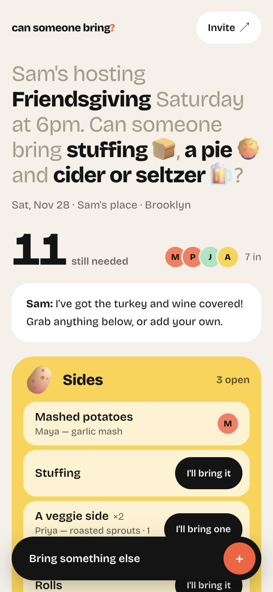
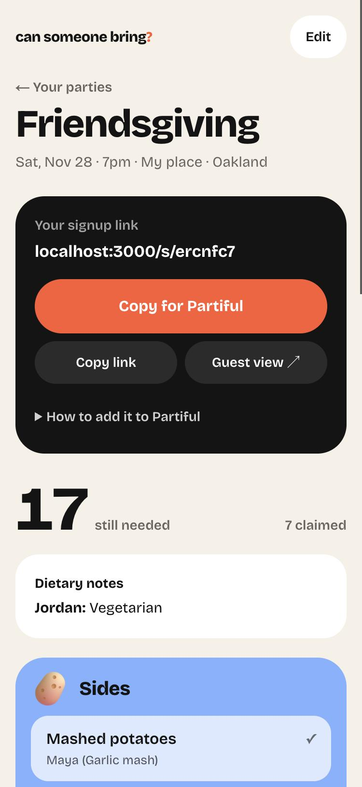
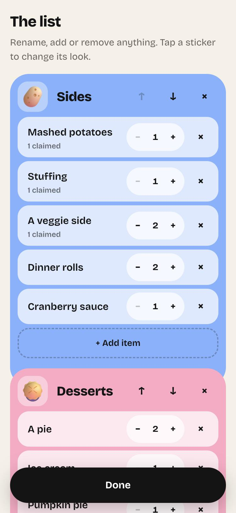

# can someone bring?

**The signup sheet for dinner parties and house parties.** Hosts make a list of what's needed, paste the link into their [Partiful](https://partiful.com) invite, and guests claim what they're bringing in two taps, with no app and no account.

> _Sam's hosting **Friendsgiving** Saturday at 6pm. Can someone bring **stuffing** 🍞, **a pie** 🥧 and **ice** 🧊?_

**Live:** [can-someone-bring.vercel.app](https://can-someone-bring.vercel.app) · **Try the guest view:** [demo sheet](https://can-someone-bring.vercel.app/s/demo) (best on your phone)

<p align="center">
  
  &nbsp;
  
  &nbsp;
  
</p>

## Why

Signup Genius is built for PTAs and volunteer shifts; Partiful nails invites and RSVPs but not "who's bringing what." This sits in between, designed around how people actually host:

1. Draft the Partiful event
2. Make a sheet here (templates for Dinner party, Friendsgiving, BBQ, House party)
3. Paste the link into the Partiful description, then send the invite
4. Guests tap through, claim a dish, done

## Features

**Guests** (no account)
- One continuous, mobile-first list. Every category is open, no extra taps
- Header sentence that updates live with what's still needed, with 3D food stickers
- Claim with just a first name, plus an optional "what exactly?" and dietary note
- Duplicate nudge: _"Heads up: Jordan is already bringing pumpkin pie."_
- Undo from the same phone (a private edit token is kept on the device)
- Bottom sheets that ride above the iOS keyboard

**Hosts** (email magic link)
- Dashboard of upcoming and past parties
- New party from a template, with a live preview of what guests will see
- List editor: rename, add, remove, reorder, quantities, per-category color and sticker
- Party page with **Copy for Partiful**, share sheet, dietary notes, and who's bringing what

## Tech

- **Next.js 15** (App Router, Server Actions) · **React 19** · **TypeScript**
- **Tailwind CSS v4** with a small design-token system
- **Supabase**: Postgres, Auth (magic link), Row Level Security
- Stickers: [Microsoft Fluent Emoji](https://github.com/microsoft/fluentui-emoji) (MIT), pinned to a commit

## Engineering notes

A few decisions I'd point to:

- **Guests never touch the database directly.** The browser key has _no_ table access. Guest reads and writes go through server code with a server-only secret key, which validates input and never returns emails or edit tokens. Nobody can enumerate parties (or their addresses) from the browser.
- **Hosts are isolated by Row Level Security.** Host requests run as the signed-in user, so Postgres policies, not app code, guarantee a host can only see and edit their own sheets. This is verified with a second test account.
- **No double-claiming the last pie.** `claim_slot` is a Postgres function that locks the slot row before counting claims. 5 simultaneous claims on a one-person item → exactly 1 succeeds.
- **Magic links survive link previews.** iMessage previews and email scanners fetch links before you tap them, which burns one-time tokens. The confirm page only verifies on a client-side form submit, which bots don't run.
- **Mobile keyboard handling.** iOS overlays the keyboard instead of resizing the page, so a `useVisualViewport` hook keeps bottom sheets and the editor's Save bar above it.
- **Works over plain HTTP on a LAN for phone testing.** That includes a `crypto.randomUUID` fallback (it's missing in non-secure contexts) and `.local` hostnames, since Supabase won't redirect to raw private IPs.

## Run it locally

```bash
npm install
cp .env.example .env.local   # fill in your Supabase project values
npm run db:migrate           # create tables, policies and functions
npm run db:seed              # demo sheet at /s/demo
npm run dev                  # http://localhost:3000
```

Other scripts:

| Command | What it does |
|---|---|
| `npm run dev:login -- you@example.com 3000` | One-time local sign-in link without sending email (dev only). Pass a full origin like `http://<your-mac>.local:3000` for a phone QR code. |
| `npx tsc --noEmit && npm run lint` | Type check and lint |

Project layout: guest page in `src/app/s/[slug]`, host pages in `src/app/{dashboard,new,sheets}`, SQL in `supabase/migrations`. See [`SPEC.md`](SPEC.md) for the product spec and roadmap.

## Roadmap

- Live updates on the host board (Supabase Realtime)
- Share-preview images for links pasted into Partiful and iMessage
- Day-before email reminders (Resend)
- Custom domain + SMTP so anyone can sign up as a host
